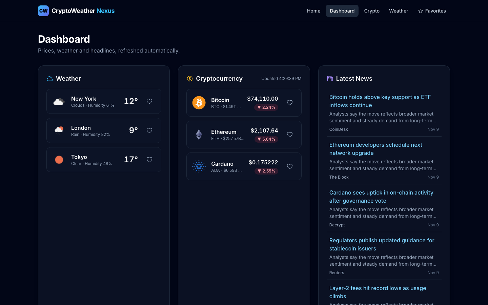
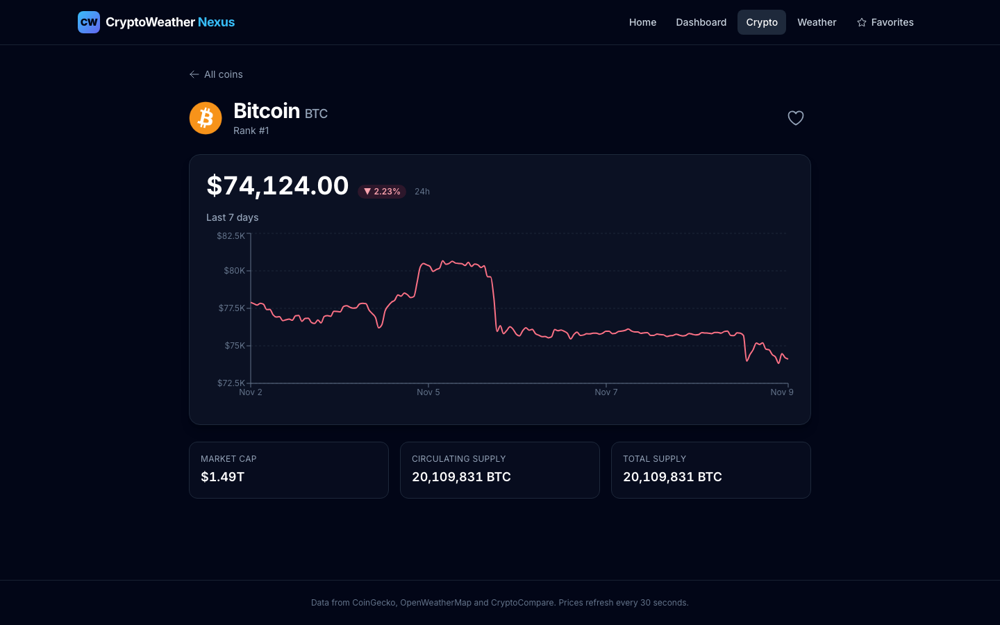
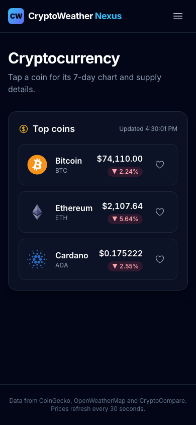

# CryptoWeather Nexus

A Next.js dashboard that combines live cryptocurrency prices, current weather for major cities and crypto news. It supports favorites and toast alerts for price and weather changes.


## Live demo

**https://crypto-weather-nexus-eta.vercel.app**

| Dashboard | Coin detail | Mobile |
| --- | --- | --- |
|  |  |  |

## Overview

The app is built on the Next.js 14 App Router. The browser only calls the app's own API routes, which fetch data from [CoinGecko](https://www.coingecko.com/) (crypto), [OpenWeatherMap](https://openweathermap.org/) (weather) and the [CryptoCompare](https://min-api.cryptocompare.com/) news API, with short in-memory caches. The OpenWeather key stays on the server. State is managed with Redux Toolkit, and favorites persist in `localStorage`. The dashboard tracks Bitcoin, Ethereum and Cardano, plus the weather in New York, London and Tokyo, and refreshes every 60 seconds.

## Features

- **Dashboard:** crypto, weather and news sections side by side, refreshed every minute
- **Crypto:**
  - list of tracked coins with price, 24h change (color-coded) and market cap
  - detail page (`/crypto/[id]`) with market cap, rank, circulating and total supply, and a **7-day price chart** (Recharts)
- **Weather:**
  - current conditions for each city: temperature, humidity, wind speed and condition icon
  - detail page (`/weather/[city]`)
- **News:** latest crypto headlines with source and timestamp
- **Favorites:** star coins and cities and view them on `/favorites`. They are saved to `localStorage`.
- **Toast notifications** (`react-hot-toast`), from a background poller that runs on every page:
  - BTC or ETH moved 1% or more since the previous check (checked every 30 s while the tab is visible)
  - a favorite city's temperature changed by 5°C or more, or its weather condition changed
- **API resilience:** the CoinGecko route retries on HTTP 429, every route caches responses in memory (30 s for prices, 5 min for weather, news and history) and serves stale data if the upstream fails
- **Input validation:** coin ids, chart ranges and city names are checked before any upstream URL is built
- **Responsive, accessible UI** with Tailwind CSS and Heroicons: skeleton loaders, empty and error states with retry, focus rings and labelled favorite buttons
- **Unit tests** with Jest and jsdom for the favorites slice, the live-update poller and the validators

## Tech stack

| Area | Tools |
| --- | --- |
| Framework | Next.js 14 (App Router), React 18, TypeScript |
| State | Redux Toolkit, React Redux |
| UI | Tailwind CSS, Heroicons, Recharts, react-hot-toast |
| Data | axios / fetch, CoinGecko API, OpenWeatherMap API, CryptoCompare news API |
| Testing | Jest, jest-environment-jsdom |
| Hosting | Vercel |

## Project structure

```
crypto-weather-nexus/
├── src/
│   ├── app/
│   │   ├── api/
│   │   │   ├── crypto/route.ts          # GET /api/crypto?ids=
│   │   │   ├── crypto/history/route.ts  # GET /api/crypto/history?id=&days=
│   │   │   ├── news/route.ts            # GET /api/news
│   │   │   └── weather/route.ts         # GET /api/weather?city=
│   │   ├── dashboard/, crypto/, crypto/[id]/, weather/, weather/[city]/, favorites/
│   │   └── layout.tsx, providers.tsx, icon.svg
│   ├── components/      # CryptoSection, WeatherSection, NewsSection, PriceChart, Navbar, ui.tsx
│   ├── hooks/           # useLiveUpdates, useRefresh
│   ├── lib/             # validation, constants (+ tests)
│   ├── services/        # liveUpdates.ts (price/weather alert poller) + tests
│   └── store/           # Redux store + crypto, weather, news, favorites slices
├── jest.config.js
└── next.config.js
```

## Getting started

### Prerequisites

- Node.js 18+ and npm
- A free [OpenWeatherMap API key](https://home.openweathermap.org/api_keys). CoinGecko and CryptoCompare news are called without a key.

### Install and run

```bash
git clone https://github.com/VamsiKrishnaThota03/crypto-weather-nexus.git
cd crypto-weather-nexus
npm install
cp .env.example .env.local   # then add your OpenWeatherMap key
npm run dev               # http://localhost:3000
```

### Environment variables (`.env.local`)

| Variable | Required | Description |
| --- | --- | --- |
| `OPENWEATHER_API_KEY` | For weather | OpenWeatherMap API key. Read only by the `/api/weather` route on the server; it is never sent to the browser. Without it the weather sections show a configuration error and everything else works. |

```env
OPENWEATHER_API_KEY=<your-openweathermap-api-key>
```

### Scripts

| Command | Description |
| --- | --- |
| `npm run dev` | Start the dev server |
| `npm run build` | Production build |
| `npm start` | Serve the production build |
| `npm run lint` | Next.js ESLint |
| `npm test` | Run Jest |
| `npm run test:watch` | Jest in watch mode |
| `npm run test:coverage` | Jest with a coverage report |

## API routes

| Method | Path | Purpose |
| --- | --- | --- |
| GET | `/api/crypto?ids=bitcoin,ethereum` | Market data for the given CoinGecko IDs (retries on 429) |
| GET | `/api/crypto/history?id=<id>&days=7` | CoinGecko `market_chart` price history used by the chart (`days`: 1, 7, 14, 30, 90, 180, 365) |
| GET | `/api/weather?city=<name>` | Current OpenWeatherMap weather for a city (metric units) |
| GET | `/api/news` | Latest six CryptoCompare headlines |

## Known limitations

- The tracked coins and cities are fixed (`src/lib/constants.ts`); there is no search to add new ones.
- "Live" updates are polling, not push: prices are checked every 30 s and the dashboard refreshes every minute.
- Caches live in server memory, so on serverless hosts each instance has its own cache and the free CoinGecko tier can still rate-limit.
- Next.js is on the latest 14.2 release; some advisories are only fixed in Next 15+, which needs a separate migration.

## Acknowledgments

- [CoinGecko](https://www.coingecko.com/) for cryptocurrency data
- [OpenWeatherMap](https://openweathermap.org/) for weather data
- [CryptoCompare](https://www.cryptocompare.com/) for news
